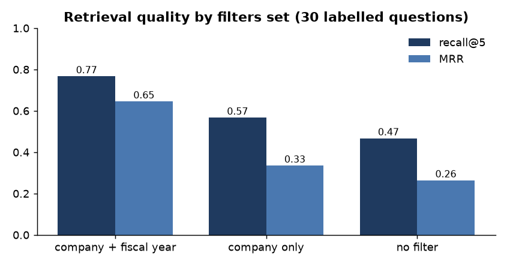
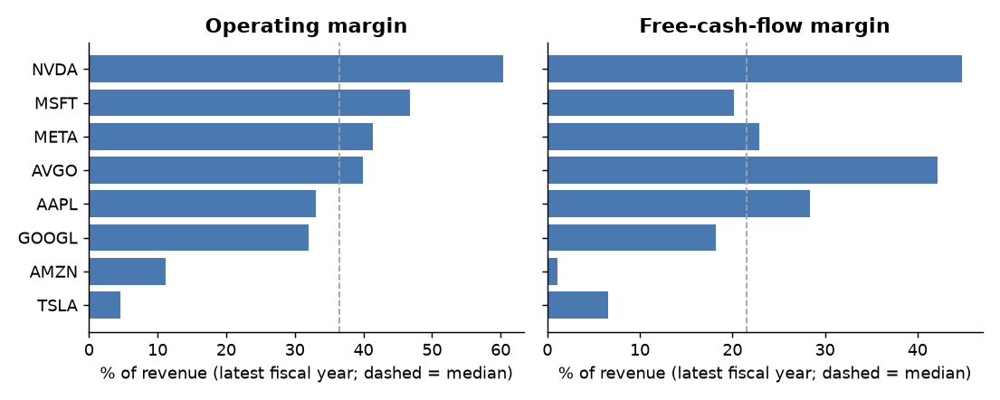
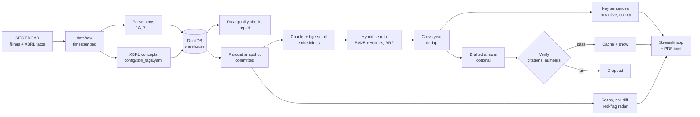

# SEC Filings AI Analyst

[](https://github.com/dmp009/sec-filings-ai-analyst/actions/workflows/ci.yml)


**Live demo:** coming soon

An analyst tool over the 10-K and 10-Q filings and the XBRL financial data of eight large US
companies (Apple, Microsoft, NVIDIA, Amazon, Alphabet, Meta, Broadcom, Tesla). You ask a question
in plain English and get the matching passages with their filing, year and item; you compare
companies on ratios whose definitions are written down; you see what changed in the risk factors
from one year to the next. It works without an API key. An LLM can draft answers on top, but a
checker drops any answer that cites a passage that was not retrieved or states a number the
passage does not contain.

## The business problem

Analysts read the same long documents every year. A 10-K runs to 100 or 200 pages, the
information that matters (risk factors, customer concentration, legal proceedings) is buried in
it, and the financial statements use different fiscal calendars and different XBRL tags from one
company to the next. Three people use this tool:

| Persona | Question they bring | What they get |
|---|---|---|
| **Equity research analyst** | What does the company say about topic X, and what changed since last year? | Passages with citations; a risk-factor diff between the latest two 10-Ks |
| **Credit / due-diligence analyst** | Where are the red flags, and how leveraged is the company? | A red-flag radar per company; debt, liquidity and cash-conversion ratios with their definitions |
| **Client-facing banker** | I meet this company on Thursday. | A one-page PDF brief: key metrics against the peer median, top risks, recent changes, all cited |

Requirements, user stories and KPIs: [docs/business_requirements.md](docs/business_requirements.md).

## What it shows

A Streamlit app with six pages: **Ask the filings**, **Due diligence** (risk-factor changes and
red-flag radar), **Benchmarking**, **Client brief** (PDF), **Data quality** and **About**. The
charts below are re-plotted with matplotlib from the committed snapshot (`make figures`). They
are not app screenshots.

| Retrieval quality, by filters set | Margins, latest fiscal year |
|---|---|
|  |  |

## Results

Data as of 2026-11-13: 8 companies, 24 10-Ks and 7 10-Qs, 4,376 searchable passages.

<!-- RESULTS:START -->
*Generated by `make readme` from the committed snapshot (data as of 2026-11-13).*

**Retrieval** (30 author-labelled questions, each aimed at a latest-year filing)

| Filters set by the user | recall@5 | MRR |
|---|--:|--:|
| company + fiscal year | 0.767 | 0.645 |
| company only | 0.567 | 0.335 |
| no filter | 0.467 | 0.263 |

**Red-flag radar precision:** 0.875 (35/40) on an out-of-sample holdout, one labeller, interval about +/-0.10.

**Benchmark, latest fiscal year per company** (fiscal years end in different months: compare by label and period end)

| Ticker | FY | Period end | Rev. growth | Gross margin | Op. margin | FCF margin | FCF conv. | ROIC | ROE | Net cash ($bn) | Debt/EBITDA | CCC (days) |
|---|---|---|--:|--:|--:|--:|--:|--:|--:|--:|--:|--:|
| AAPL | 2026 | 2026-09-26 | 15.1% | 48.8% | 33.0% | 28.4% | 102.9% | 231.3% | 117.9% | 55.4 | 0.48x | -67 |
| AMZN | 2025 | 2025-12-31 | 12.4% | 50.3% | 11.2% | 1.1% | 9.9% | 17.4% | 18.9% | 41.9 | 0.56x | -51 |
| AVGO | 2025 | 2025-11-02 | 23.9% | 67.8% | 39.9% | 42.1% | 116.4% | 19.6% | 28.4% | -49.0 | 1.91x | 53 |
| GOOGL | 2025 | 2025-12-31 | 15.1% | 59.7% | 32.0% | 18.2% | 55.4% | 31.6% | 31.8% | 75.8 | 0.34x | n/a |
| META | 2025 | 2025-12-31 | 22.2% | 82.0% | 41.4% | 22.9% | 76.3% | 30.0% | 27.8% | 21.7 | 0.59x | n/a |
| MSFT | 2026 | 2026-06-30 | 17.8% | 67.9% | 46.8% | 20.2% | 50.1% | 26.5% | 30.2% | -30.0 | 0.55x | -52 |
| NVDA | 2026 | 2026-01-25 | 65.5% | 71.1% | 60.4% | 44.8% | 80.5% | 89.3% | 76.3% | 33.4 | 0.06x | 133 |
| TSLA | 2025 | 2025-12-31 | -2.9% | 18.0% | 4.6% | 6.6% | 163.9% | 6.8% | 4.6% | 35.7 | 0.89x | 13 |
<!-- RESULTS:END -->

**How to read these numbers**

- **Retrieval.** The 30 questions were written and labelled by the author, each aimed at a
  latest-year filing, and a hit needs the right company, year, item and key phrase. With company
  and year chosen, as a user does in the app, the labelled passage is in the top 5 for 77 % of
  questions. Without filters it is 47 %: the index holds three years of each filing, eight
  companies and the same topics (export controls, cybersecurity, customers) in several items, so a
  passage from another company, an older year or another item can outrank the labelled one. The
  label is strict, so the unfiltered figures understate usefulness somewhat. Small sample, wide
  error band.
- **Radar.** 35 of 40 hits were really about the topic on a holdout that was never used to tune
  the rules. One labeller and 40 labels give an interval of about +/-0.10. Earlier in-sample
  figures (0.41, 0.79, 0.85) are kept in [the calibration notes](docs/design/risk-diligence-notes.md)
  because the 0.85 was an overestimate.
- **Ratios.** `n/a` means an input is missing and `n/m` not meaningful; neither is imputed.
  Fiscal years end in different months, so "latest" is not the same period for every company.
  Apple's ROIC (231 %) is high because its invested capital is small; for FY2022 to FY2024 it is
  n/m for that reason.

## How it works



1. **Ingest** (`secanalyst/ingest/`): downloads submissions, company facts and filings, rate
   limited and retried, with a User-Agent that names a contact.
2. **Parse and store** (`secanalyst/parse/`, `warehouse/`): 10-Ks and 10-Qs are split into items
   and loaded into DuckDB; XBRL facts are mapped to named concepts. Quality checks write
   [data_quality_report.md](data_quality_report.md) (0 errors, 3 warnings on this run).
3. **Financials** (`secanalyst/financials/`): 15 ratios per company and year with explicit
   rulings: operating leases excluded, finance leases included, liquidity without long-term
   equity investments, ROIC n/m when invested capital is under 10 % of total assets, a rule for
   missing depreciation and amortization. See [docs/methodology.md](docs/methodology.md).
4. **Retrieval** (`secanalyst/retrieval/`): about 320-word chunks, BM25 plus bge-small embeddings
   fused by reciprocal-rank fusion; the same passage repeated across fiscal years is shown once.
5. **Due diligence** (`secanalyst/diligence/`): risk-factor diff and a keyword red-flag radar.
6. **Answers** (`secanalyst/answer/`) and **outputs** (`secanalyst/outputs/`, `app/`).

## AI without a key

The tool is usable with no key and no network.

| Mode | What you get | Label in the app |
|---|---|---|
| **Extractive** (default) | The most relevant verbatim sentences from the retrieved passages, each with its citation. Nothing is generated. | "Key sentences (extractive, not AI-written)" |
| **Drafted** (optional, needs `ANTHROPIC_API_KEY`) | A written answer with citations to chunk ids | "AI-drafted answer (verified against the cited passages)" |

A drafted answer is shown only if every cited chunk was retrieved and every number in it appears
in a cited passage with the same value, scale (thousand, million, billion), percent flag and
sign. One retry, then it is dropped. Verified answers are cached. A daily cap on calls is a
best-effort local counter that resets when a cloud host restarts, so **set a monthly spend limit
in the Anthropic console** if you run it with a key. No drafted answers are committed yet.

## Data governance

- **Source.** SEC EDGAR only (filings and XBRL company facts), as of 2026-11-13.
- **Fair access.** At most 8 requests per second, retries with back-off, and a User-Agent with a
  contact. The contact is read from a local `.env` (git-ignored) and never appears in the
  repository.
- **Traceability.** Every passage carries company, form, fiscal year, period end and item; every
  financial value keeps its XBRL tag and accession number.
- **Quality.** 11 automated checks (missing items, label mismatches, schema, missing concepts);
  gaps are reported, never filled. See [docs/data_dictionary.md](docs/data_dictionary.md) and
  [docs/data_model.md](docs/data_model.md).

## Quickstart

```bash
git clone https://github.com/dmp009/sec-filings-ai-analyst.git
cd sec-filings-ai-analyst
make install          # python3.13 venv; or: python -m venv .venv && .venv/bin/pip install -e ".[dev]"
make app              # opens the Streamlit app on the committed snapshot (no key, no network)
make test lint        # test suite and ruff
```

To rebuild the data from EDGAR, put a contact in a local `.env` (the SEC asks for one):

```bash
echo "SEC_CONTACT=<your contact>" > .env
.venv/bin/python -m secanalyst.pipeline ingest   # download
.venv/bin/python -m secanalyst.pipeline build    # warehouse, quality report, snapshot
.venv/bin/python -m secanalyst.pipeline index    # chunks and embeddings
.venv/bin/python -m secanalyst.pipeline diligence
.venv/bin/python -m secanalyst.pipeline eval     # recall@5 and MRR
make readme figures   # refresh the results block and the figures
```

For drafted answers, set `ANTHROPIC_API_KEY` and run `python -m secanalyst.pipeline ai`.

Deployment: Streamlit Cloud: choose Python 3.13; entry app/Home.py; the embedding model (~70 MB)
downloads on first start. The package supports Python 3.11+ (CI runs 3.11); the deployed app and
the pinned `requirements.txt` use 3.13.

## Structure

```
app/                 Streamlit app (6 pages) and chart helpers
config/              companies, XBRL tag map, red-flag keywords, example questions, settings
data/snapshot/       committed parquet snapshot, chunks and embeddings
data/eval/           30 labelled retrieval questions
docs/                business requirements, data dictionary and model, methodology, design notes
scripts/             README results block and figures
secanalyst/          ingest, parse, warehouse, financials, retrieval, diligence, answer, outputs
tests/               unit and data tests
```

## Limitations

- Eight large US technology companies, three 10-Ks each: not a sample of the market.
- Fiscal years differ (September, June, January, October/November, December), so latest-year
  comparisons mix periods.
- XBRL tag gaps: Alphabet and Meta report no inventory and Broadcom's D&A is missing for two
  years, so those ratios are n/a. A filer's tag may also be missing from the tag map.
- The retrieval set has 30 questions, written and labelled by the author, on latest filings only.
- The radar is keyword-based. It finds passages that name a topic; recall is not measured and
  precision comes from one labeller.
- No LLM answers are committed yet; the drafted path is tested with a fake client only.

## Disclaimer

Educational project, not investment advice. Source: SEC EDGAR. Figures may contain errors;
check the filing before relying on any number.

## Résumé en français

Cet outil d'analyse porte sur les rapports 10-K et 10-Q de huit grandes entreprises américaines
et sur leurs données financières XBRL. Il répond à des questions en langage naturel en renvoyant
les passages exacts avec leur source, compare les entreprises sur des ratios dont les définitions
sont explicites (location-financement incluse, ROIC non significatif quand le capital investi est
trop faible), et repère les changements dans les facteurs de risque. Il fonctionne sans clé d'API
: des phrases extraites des filings. Une réponse rédigée par un LLM reste optionnelle et n'est
affichée qu'après vérification des citations et des chiffres. Sur 30 questions annotées, le bon
passage est dans les 5 premiers résultats dans 77 % des cas avec filtres entreprise et année.
Projet pédagogique, pas un conseil en investissement.
