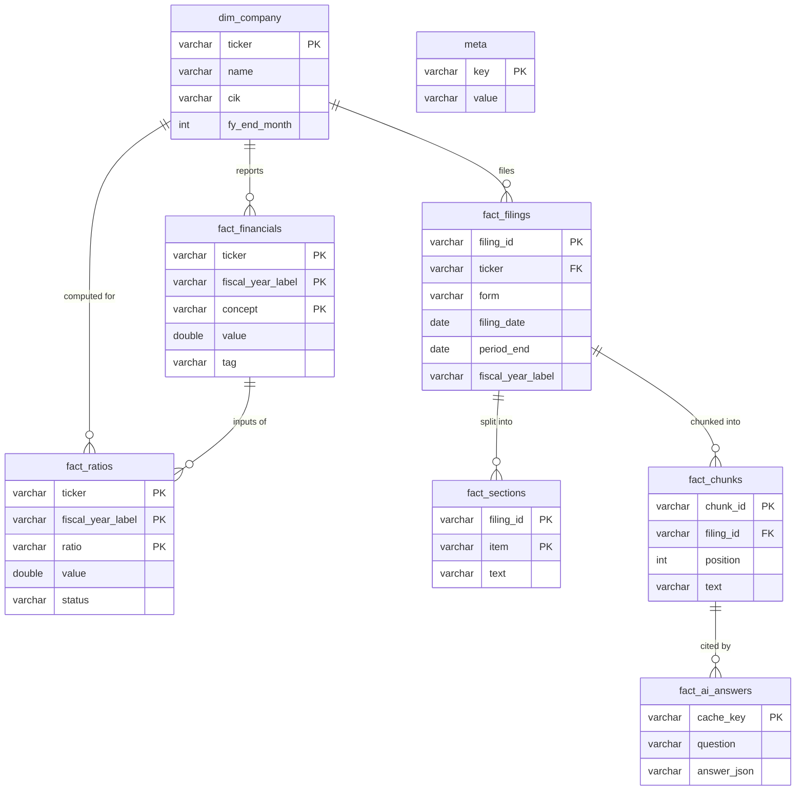

# Data model

The warehouse is a DuckDB file (`data/warehouse.duckdb`, not committed) rebuilt from the raw
EDGAR files; the committed copy of the data is `data/snapshot/*.parquet`. DDL: `secanalyst/warehouse/schema.sql`.
Column definitions: [data_dictionary.md](data_dictionary.md).

Notes

- Relations are logical: DuckDB enforces the primary keys and the `status` check on `fact_ratios`,
  the quality checks enforce the rest (for example a section without a filing is an error).
- The snapshot adds three derived files that are not warehouse tables: `chunks.parquet` with
  `vectors.npy` (the search index), `risk_diff.parquet` and `radar.parquet` (due diligence).
- A ratio row exists for every (company, fiscal year, ratio), with `status` `ok`, `n/a` or `n/m`.
- `fact_chunks` is declared in the schema but stays empty: the 4,376 chunks live in
  `chunks.parquet` (same columns plus `period_end`), which the search reads. `fact_ai_answers` is
  empty until a drafted answer is committed (none yet); the live cache is `data/ai_cache/`.
